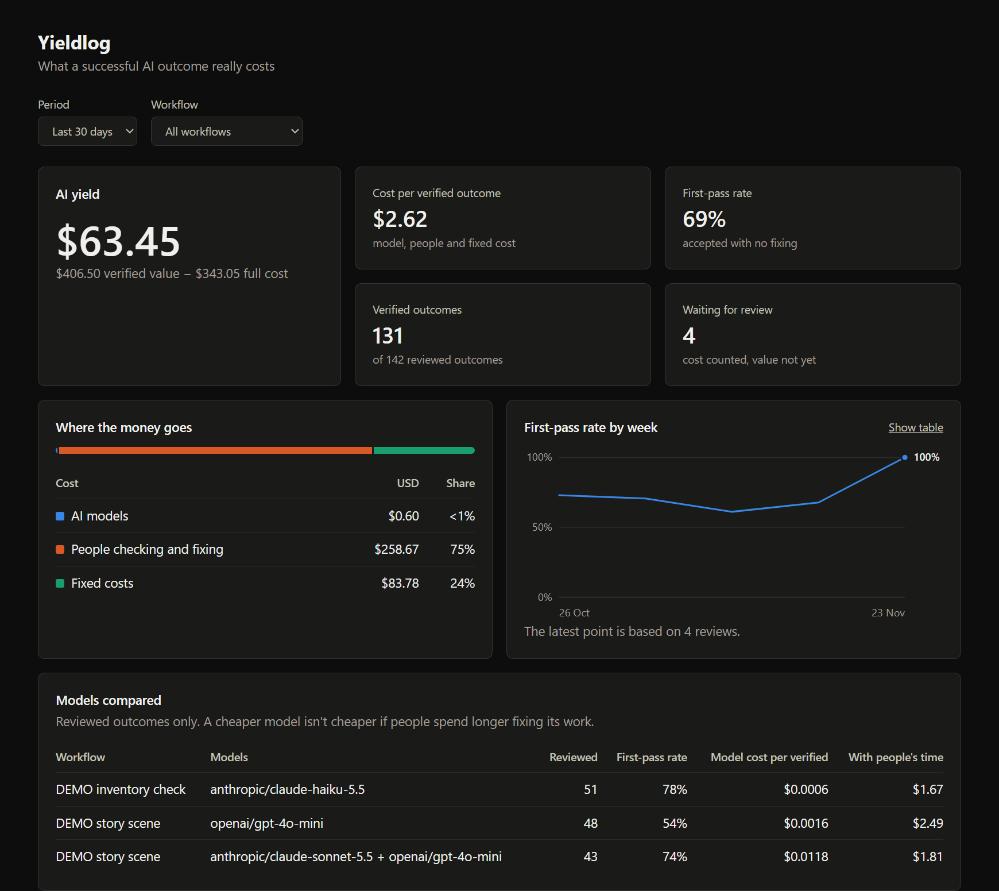
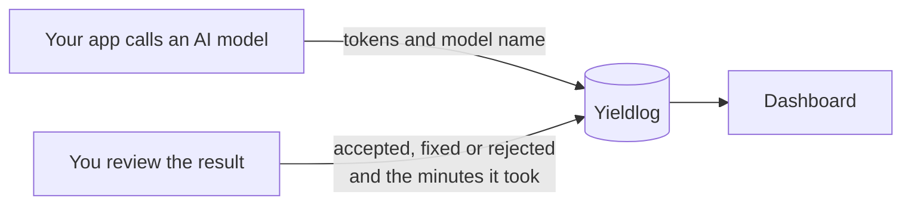

# Yieldlog

**Find out what your AI feature really costs, including the time people spend checking and fixing its work.**



*The dashboard with made-up demo data.*

## Why

An AI call might cost a fraction of a cent. But if someone spends five minutes fixing the answer, that time is the real cost, and it never shows up on the AI bill.

Yieldlog puts both in one place, so you can answer two questions:

1. **Is this AI feature worth more than it costs?**
2. **Which model is cheapest once people's time is included?**

## An example

Say AI writes 10 product descriptions, and a person paid $30 an hour reviews them:

| What happened | Amount |
| --- | ---: |
| AI fees | $0.10 |
| Checking all 10, 2 minutes each | $10.00 |
| Fixing 3 of them, 10 minutes each | $15.00 |
| **Full cost** | **$25.10** |
| 9 usable descriptions worth $4 each (1 was rejected) | $36.00 |
| **AI yield: value − full cost** | **$10.90** |

Going by AI fees alone, each usable description cost about 1 cent. The real figure is **$2.79**.

## How it works



| Word | Meaning |
| --- | --- |
| **Workflow** | A job you use AI for, such as "product descriptions" |
| **Outcome** | One finished piece of that work. It can take several AI calls. |
| **Verified** | A person accepted it, either as it was or after fixing it |
| **First-pass rate** | The share of reviewed outcomes accepted with no fixing |
| **AI yield** | The value of the verified outcomes minus everything they cost |

## Try the demo

You need [Node.js](https://nodejs.org) 24 or newer. There is nothing else to install.

```sh
git clone https://github.com/aaji123/ai-yieldlog.git
cd ai-yieldlog
npm run demo
```

Open http://localhost:4601. Nothing you change in the demo is saved.

## Use it with your own app

**1. Start Yieldlog** and open http://localhost:4600. Your data is saved in `yieldlog.db`.

```sh
npm start
```

**2. Log your AI calls.** Copy one file into your app, then pass on the `usage` your AI provider returns.

TypeScript, with [clients/yieldlog.ts](clients/yieldlog.ts):

```ts
import { startOutcome } from "./yieldlog";

const run = await startOutcome({ workflow: "product descriptions", ref: "Blue mug" });

// ...call your AI model as usual, then:
await run.logCall({ model: "openai/gpt-4o-mini", usage: response.usage });
```

Python, with [clients/yieldlog.py](clients/yieldlog.py):

```python
from yieldlog import Outcome

run = Outcome("product descriptions", ref="Blue mug")

# ...call your AI model as usual, then:
run.log_call("openai/gpt-4o-mini", response.usage.model_dump())
```

**3. Set the values.** On the dashboard, enter what one outcome is worth and what the reviewer's time costs.

**4. Review outcomes** as they come in. The figures update with each review.

Usage in the Anthropic or OpenAI format works, which covers OpenAI, OpenRouter and Groq. If you stream responses, use the usage from the last chunk; some providers only send it if you ask. If Yieldlog isn't running, your app carries on without it.

## How it's calculated

| Figure | Calculation |
| --- | --- |
| AI models | The cost the provider reported, or tokens × list price |
| People | (Checking + fixing minutes) × hourly cost |
| Fixed costs | Monthly cost of hosting, tools and so on, spread over the period |
| Value | Verified outcomes × value of one |
| **AI yield** | **Value − (AI models + people + fixed costs)** |
| Cost per verified outcome | All costs ÷ verified outcomes |
| First-pass rate | Accepted without fixing ÷ all reviewed |

Four choices keep the numbers honest:

- **Failures count.** Rejected outcomes still cost money, so they are part of what the good ones cost.
- **Unknown isn't free.** A call without a known price is flagged, not counted as $0.
- **History stays put.** Each cost is saved when it's logged, so later price changes don't alter it.
- **Models are compared fairly.** Only within the same workflow, so easier work can't make a model look better.

## Privacy and limits

Yieldlog never stores prompts or answers. It keeps token counts, costs, review minutes and the label you choose, all on your own computer.

- The results are only as good as the values and minutes you enter.
- A model comparison with few reviews can mislead.
- List prices come from [OpenRouter](https://openrouter.ai) and may differ from your provider's. Update them with `npm run prices`.
- It's for one person, uses US dollars, and only accepts requests from the same computer. An app running online can't reach it.

## The code

TypeScript on Node.js with its built-in SQLite, and a plain JavaScript dashboard. It runs without any dependencies.

| File | What it does |
| --- | --- |
| [src/metrics.ts](src/metrics.ts) | All the calculations. Start here. |
| [src/pricing.ts](src/pricing.ts) | Turns token counts into a cost |
| [src/store.ts](src/store.ts) | Saves and reads the data |
| [src/server.ts](src/server.ts) | The API and the dashboard's web server |
| [src/demo.ts](src/demo.ts) | Creates the demo data |
| [public/](public) | The dashboard |
| [test/](test) | The tests |

```sh
npm test            # run the tests

npm install         # only needed once, for type checking
npm run typecheck
```

## Background

The idea comes from Capgemini's [November 2026 research on AI costs](https://www.capgemini.com/news/press-releases/most-organizations-plan-to-adopt-a-multi-model-ai-strategy-as-nearly-six-in-ten-faced-significantly-higher-ai-costs-than-expected/). It found that only one in five organizations calculates AI yield: the verified value of an AI-assisted outcome after its full cost.

This is an independent student project, built with the help of AI. It isn't connected to Capgemini.
